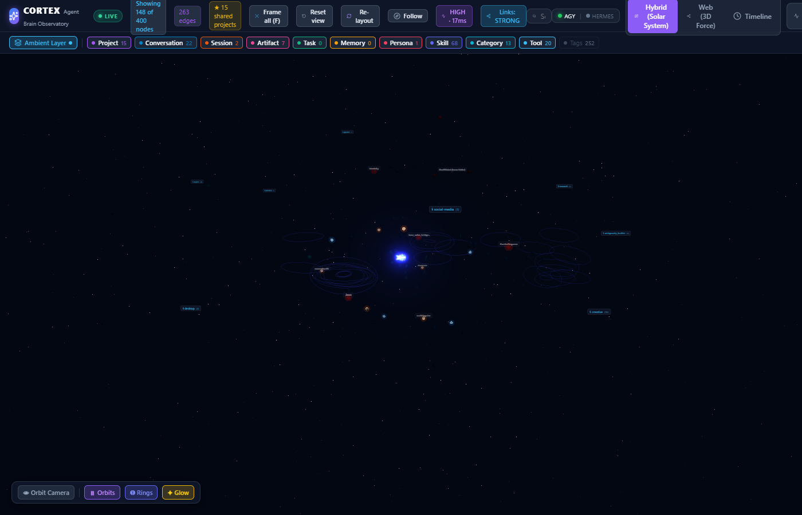
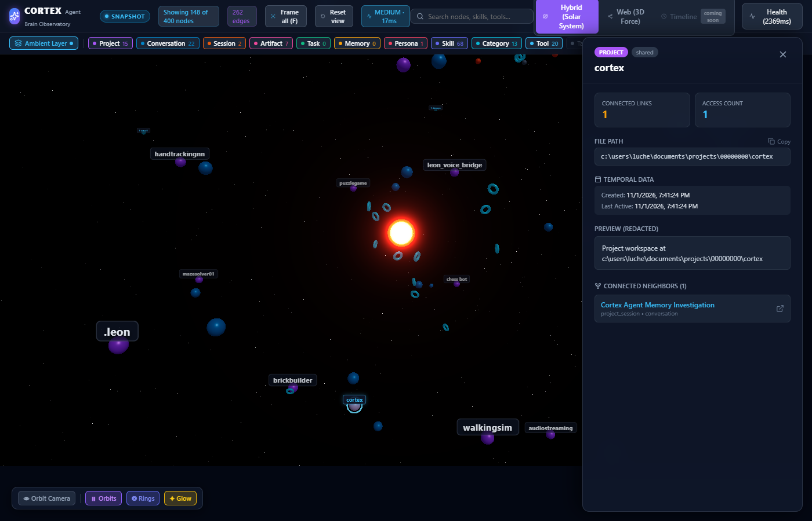
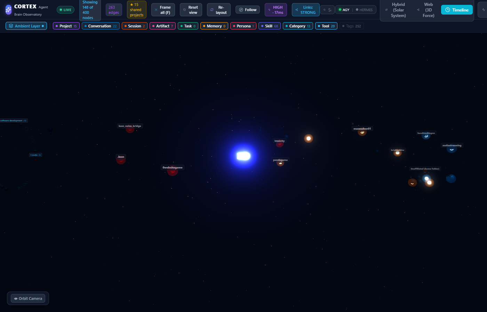
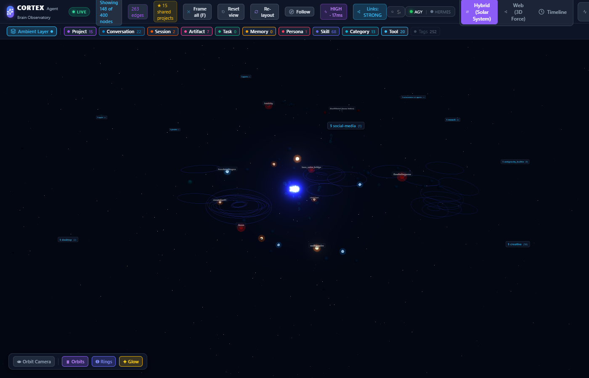
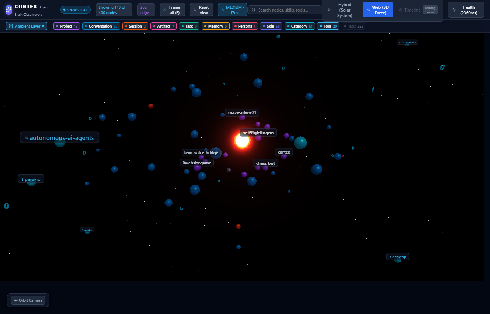
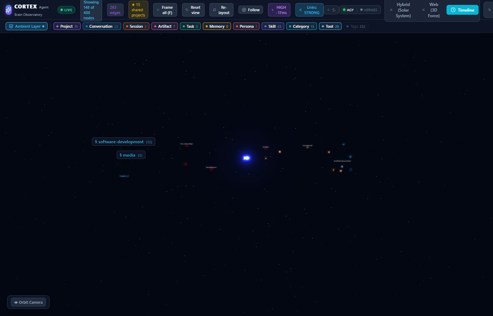
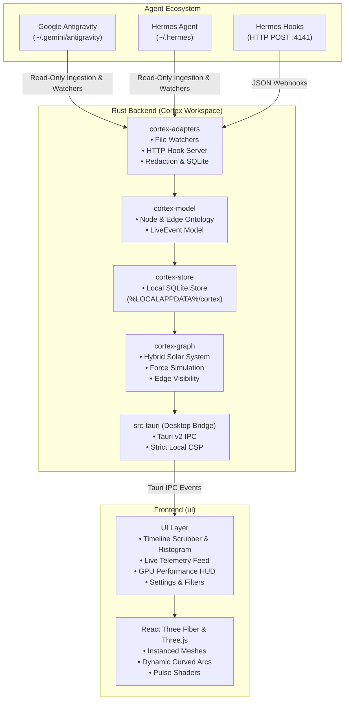

# 🧠 Cortex — 4D Agent Memory Observatory

[](https://www.rust-lang.org/)
[](https://tauri.app/)
[](https://react.dev/)
[](https://threejs.org/)
[](LICENSE)
[](#-security--privacy-first)

**Cortex** is a 4D memory observatory and real-time neural telemetry visualizer for autonomous AI agents. It discovers, indexes, and visualizes cognitive memory graphs across agent runtimes — including **Google Antigravity** and **Hermes Agent (Nous Research)** — rendering thought trajectories, projects, conversations, artifacts, and memories as an interactive 3D solar system and cylindrical timeline.

---

## 🌟 Key Features

### 🪐 1. Hybrid 3D Solar System Layout
- **Agent Celestial Hierarchy**: Visualizes agent cognition like a galaxy:
  - **Root Agent Star**: The central cognitive nucleus.
  - **Project Suns**: Major development workspaces and domains orbiting the center.
  - **Conversation Planets & Moons**: Individual chat sessions and threads orbiting project nodes.
  - **Memory Asteroids**: Long-term memories (`MEMORY.md`, `USER.md`) clustered in gravitational orbits.
  - **Skill & Tool Nebulae**: Autonomous capabilities and MCP tools floating in an exterior galactic disk.
- **Dynamic Orbital Animation**: Orbiting nodes follow live mathematical planetary paths, with dynamic bezier arcs stretching smoothly between interacting nodes each frame.

### ⏳ 2. 3D Cylindrical Timeline Mode & Replay Scrubber
- **Temporal Cylinder Projection**: Maps memory creation along an interactive temporal Z-axis, with circular angular distribution by project.
- **Automated Idle Gap Compression**: Intelligently compresses inactive spans (e.g., overnight or multiday gaps) to preserve fluid narrative continuity.
- **Scrubber & Activity Histogram**: Step-by-step 4D time-travel playback with play/pause (`Space`), speed multipliers (`1x`, `2x`, `5x`, `10x`), and visual activity density bars.

### ⚡ 3. Real-Time Telemetry & Event Streaming
- **Live In-Process File Watchers**: Monitors `transcript.jsonl`, `brain/` artifacts, and memory stores with low-overhead incremental tailing.
- **Embedded Hermes Hook Listener**: In-memory HTTP server listening on `127.0.0.1:4141` receiving live JSON event payloads (`step_start`, `step_complete`, `tool_call`, `artifact_create`, `memory_save`).
- **Live Pulse Wave Rings**: Expanding kinetic neon rings pulse outward from active nodes in real time during cognitive operations.
- **Live HUD Feed**: Collapsible sliding telemetry panel displaying streaming agent activity with direct node focus links.

### 🛡️ 4. Security & Privacy First
- **100% Local & Air-Gapped**: Zero outbound network requests at runtime. Enforced by Tauri Content Security Policy (`default-src 'self'`).
- **Strict Read-Only Access**: Opens agent SQLite databases and files with read-only flags (`SQLITE_OPEN_READ_ONLY`) — never writes, mutates, or locks agent data.
- **In-Memory PII & Key Redaction**: Automated pattern scrubber masks OpenAI, Anthropic, Gemini, and generic API keys before graph ingestion.

### 📊 5. In-App Diagnostics & GPU Performance HUD
- Press backtick (`` ` ``) to toggle real-time performance telemetry:
  - Framerate (FPS) and frametime (ms)
  - Three.js draw calls and triangle counts
  - Memory heap utilization
  - Rendered node and edge counts
  - Active layout and visual quality level

---

## 📸 Screenshots

| 3D Hybrid Solar System Galaxy | System Closeup & Planetary Orbits |
| :---: | :---: |
|  |  |

| 3D Cylindrical Timeline & Replay Scrubber | Live Telemetry Pulses & Activity Feed |
| :---: | :---: |
|  |  |

| Force-Directed Relational Web Mode | Hermes Agent Hook Settings |
| :---: | :---: |
|  |  |

---

## 🏗️ Architecture



### Workspace Structure

| Crate / Directory | Description |
| :--- | :--- |
| **`crates/cortex-model`** | Domain types: `GraphNode`, `GraphEdge`, `NodeKind`, `EdgeKind`, `LiveEvent`. |
| **`crates/cortex-adapters`** | Ingestion logic for Antigravity & Hermes, file watching, HTTP hook server, PII redaction. |
| **`crates/cortex-graph`** | Graph mathematics, Hybrid Solar System positioning, force simulation, and render rules. |
| **`crates/cortex-store`** | Persistent SQLite storage (`cortex.db`), query caching, and incremental indexing. |
| **`crates/cortex-cli`** | Headless CLI for scanning, graph metrics, and JSON snapshot exporting. |
| **`src-tauri`** | Tauri v2 desktop application, native window management, and IPC command handlers. |
| **`ui`** | React 19 + TypeScript + Vite + React Three Fiber + TailwindCSS interface. |

---

## 💻 System Requirements

- **Operating System**: Windows 10/11 (64-bit), macOS 12+, or modern Linux (Ubuntu 22.04+).
- **Rust**: Version 1.80 or later (on Windows: MSVC toolchain via `rustup default stable-x86_64-pc-windows-msvc`).
- **Node.js**: LTS version (Node 20+ or Node 22+) with `npm`.
- **WebView2**: Microsoft Edge WebView2 Runtime (preinstalled on Windows 10/11).
- **C++ Build Tools**: Visual Studio Build Tools (C++ Desktop development workload on Windows).

---

## 🚀 Installation & Getting Started

### 1. Clone the Repository
```bash
git clone https://github.com/KappinChromie/CORTEX.git
cd CORTEX
```

### 2. Install Frontend Dependencies
```bash
# Install UI dependencies
npm --prefix ui install

# Install root scripts
npm install
```

### 3. Run in Desktop Development Mode
Launches the native Tauri desktop app with live reload:
```bash
npm run tauri:dev
```
> **Note**: On startup, Cortex automatically scans your local agent directories (`.gemini/antigravity` and `.hermes`), initializes its SQLite store in `%LOCALAPPDATA%\cortex\cortex.db`, and opens the 3D visualizer in **LIVE** mode.

### 4. Run in Browser Development Mode (with Snapshot)
If you wish to inspect the frontend in a standard web browser:
```bash
# Export latest graph snapshot from your agents
cargo run -p cortex-cli -- export --output ui/public/snapshot.json

# Launch Vite dev server
npm --prefix ui run dev
```
Open `http://localhost:5173` in your browser (badge will show **SNAPSHOT**).

### 5. Build Production Release Executable
```bash
npm run tauri:build
```
The compiled, standalone Windows executable will be generated at:
`target/release/cortex-desktop.exe` (along with the `.msi` / `.exe` installer in `target/release/bundle/`).

---

## 🛠️ CLI Usage (`cortex-cli`)

Cortex includes a standalone command-line tool for headless environments, CI pipelines, and automation:

### Ingest & Scan Local Agents
```bash
cargo run -p cortex-cli -- scan
```
*Discovers all conversations, memories, artifacts, skills, and tools, then commits them to the local store.*

### View Store Statistics
```bash
cargo run -p cortex-cli -- stats
```
*Outputs total node and edge counts broken down by category and agent runtime.*

### Export Graph Snapshot to JSON
```bash
cargo run -p cortex-cli -- export --output snapshot.json
```

---

## 🤖 Connecting Your AI Agents

### 1. Google Antigravity
Cortex auto-discovers Antigravity without requiring any manual configuration.
- Discovers:
  - Conversations: `%USERPROFILE%\.gemini\antigravity\conversations\*.db`
  - Artifacts & Summaries: `%USERPROFILE%\.gemini\antigravity\brain\<uuid>\*.md`
  - Transcripts: `%USERPROFILE%\.gemini\antigravity\brain\<uuid>\.system_generated\logs\transcript.jsonl`
  - Skills: `%USERPROFILE%\.gemini\antigravity\builtin\skills\*\SKILL.md`
- Real-time watcher automatically streams new steps and artifacts as they are generated.

### 2. Hermes Agent (Nous Research)
Cortex automatically detects `~/.hermes` (`state.db`, `SOUL.md`, `MEMORY.md`, `USER.md`).

To enable real-time telemetry streaming from Hermes into Cortex, configure the webhook listener:
1. Open Cortex **Settings** (gear icon in the top right).
2. Ensure the **Hermes Hook Server** is enabled (default port: `4141`).
3. Add the webhook endpoint to your `~/.hermes/config.yaml`:

```yaml
hooks:
  enabled: true
  webhook_url: "http://127.0.0.1:4141/api/events"
  events:
    - step_start
    - step_complete
    - tool_call
    - artifact_create
    - memory_save
```

You can test the hook listener at any time with PowerShell or curl:
```powershell
Invoke-RestMethod -Uri "http://127.0.0.1:4141/api/events" -Method Post -ContentType "application/json" -Body '{"type":"step_complete","agent":"hermes","session_id":"test-session","content":"Executed unit test suite"}'
```

---

## 🎮 Controls & Shortcuts

| Action | Control | Description |
| :--- | :--- | :--- |
| **Rotate / Orbit** | `Left Click + Drag` | Rotates the 3D camera around the focal center. |
| **Pan** | `Right Click + Drag` | Pans the camera horizontally and vertically. |
| **Zoom** | `Mouse Wheel` | Zooms in/out with smooth perspective scaling. |
| **Select Node** | `Left Click` | Selects a node, highlights connected edges, and opens the inspector. |
| **Focus Selection** | `F` | Animates the camera directly into the selected node. |
| **Clear / Reset** | `C` or `Esc` | Clears current selection and resets camera to galaxy overview. |
| **Toggle Performance HUD** | `` ` `` (Backtick) | Toggles the diagnostic GPU & engine telemetry overlay. |
| **Toggle Live Feed** | `Feed Button` | Opens/closes the real-time activity stream drawer. |
| **Play / Pause Replay** | `Space` | Plays or pauses the 4D timeline replay scrubber in Timeline Mode. |

---

## 🧪 Verification & Testing

Run all backend unit and integration tests (42 passing tests):
```bash
cargo test --workspace
```

Verify backend code quality and linting:
```bash
cargo clippy --workspace -- -D warnings
```

Verify frontend TypeScript compilation and bundling:
```bash
npm --prefix ui run build
```

---

## 🔒 Privacy & Security Policy

Cortex is built from the ground up to protect your sensitive cognitive data:
- **No Cloud Required**: Cortex runs entirely on your local machine.
- **Strict Content Security Policy**: Embedded browser runs under `default-src 'self'` — network requests to external domains are blocked.
- **Non-Destructive**: SQLite databases are opened with immutable, read-only connections. Cortex will never overwrite agent memories or session histories.
- **Sanitized Exports**: Any exported snapshots automatically strip out detected secrets and keys.

---

## 📜 License

MIT License. See [LICENSE](LICENSE) for details. Built for developers, researchers, and AI engineers exploring the frontiers of autonomous cognitive architectures.
